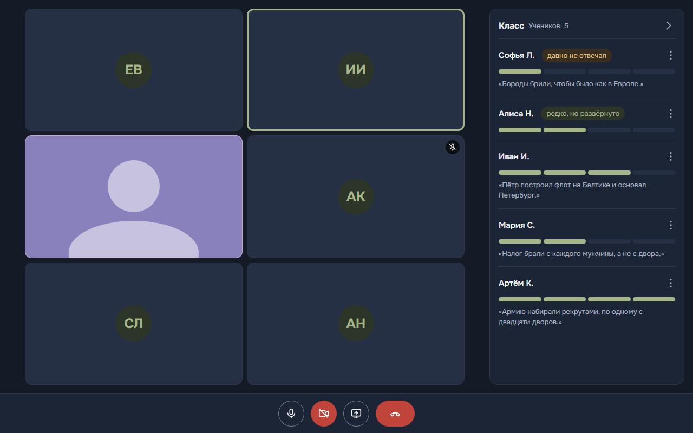

# Сферум AI

Помощник учителя на дистанционном уроке. Во время звонка невидимый ассистент слышит каждого ученика отдельно, распознаёт речь и ведёт шкалу участия: учитель видит участие всего класса, ученик — только свою шкалу. После урока учитель получает в боте сводку — кто вытянул урок, кто выпал и кого спросить в следующий раз, — а каждый ученик получает личную карточку.

Работает в MAX: бот ведёт классы и присылает итоги, звонок идёт в мини-приложении.



- Аудио не записывается: звук обрабатывается в памяти, хранится только текст реплик.
- Ученик не видит чужих шкал и рейтингов; шкала только растёт.
- Учитель может выключить аналитику любому ученику одним нажатием.

## Проверка

Нужны Docker с Docker Compose и [Git LFS](https://git-lfs.com): записанный урок для проверки лежит в LFS. Первая сборка занимает около 5 минут (образ около 2,5 ГБ: модель распознавания скачивается сразу в образ).

### 1. Запуск

```bash
git lfs install
git clone https://github.com/frontmany/lesson_assistant.git
cd lesson_assistant
cp .env.example .env
```

В `.env` впишите `LIVEKIT_NODE_IP` — IPv4-адрес этого компьютера в локальной сети (`ipconfig` в Windows, `ip addr` в Linux). По нему браузеры получают звук звонка.

```bash
docker compose up --build
```

Поднимаются приложение, сервер звонков LiveKit, PostgreSQL и Redis. Готово, когда в логе появится `Application startup complete`.

### 2. Урок в браузере, без MAX

Так проверяется главное — звонок, распознавание и шкалы — без бота и без телефона. Вместо учеников в звонок заходит записанный урок истории: каждый ученик — отдельный участник со своим голосом.

1. Запустите записанный класс:

   ```bash
   curl -X POST http://localhost:8000/api/lessons/10a-history-05/virtual-class
   ```

2. Откройте http://localhost:8000/teacher.html и нажмите «Войти в урок». Микрофон не обязателен: «Войти без микрофона».
3. Через полминуты в панели «Класс» начнут расти шкалы участия, под именами появятся последние реплики и метки «давно не отвечал», «редко, но развёрнуто». Урок длится около 6 минут.
4. Экран ученика — во второй вкладке: http://localhost:8000/student.html?id=artem_k.

Сводка учителю и карточки ученикам приходят в бот MAX — это следующий шаг.

### 3. Бот и мини-приложение в MAX

Для бота нужны три вещи: свой бот MAX, публичный HTTPS-адрес приложения и этот адрес в настройках бота.

1. **Бот.** Создайте бота в [MAX для бизнеса](https://business.max.ru/self) и впишите его токен в `.env`: `MAX_BOT_TOKEN=…`. Бот запускается вместе с сервером.
2. **HTTPS-адрес.** Мини-приложение MAX открывается только по HTTPS. Скрипт поднимет туннели Cloudflare к приложению и к LiveKit и напечатает адрес:

   ```bash
   ./scripts/tunnel.sh                                          # Linux, macOS
   powershell -ExecutionPolicy Bypass -File scripts\tunnel.ps1  # Windows
   ```

   В выводе будет строка `Приложение: https://….trycloudflare.com/`. Скрипт сам перезапускает приложение и держит туннели, пока он запущен; Ctrl+C закрывает их.
3. **Адрес в боте.** В настройках бота на [business.max.ru](https://business.max.ru/self) укажите этот адрес как ссылку мини-приложения.
4. **Проверка.** Напишите боту `/start`:
   - «Посмотреть демо» — урок записанного класса глазами учителя, можно в одиночку. «Завершить урок» — и сводка придёт в чат;
   - «Я учитель» — создать класс и пригласить учеников ссылкой или кодом; «Начать урок» — звонок, ученики получают приглашение в боте. После урока учитель получает сводку, ученики — карточки.

Ограничения запуска без сервера:

- **Телефоны и компьютер — в одной Wi-Fi-сети.** Через туннель идёт только страница и управление звонком, а звук LiveKit передаёт напрямую на `LIVEKIT_NODE_IP`. С мобильного интернета в урок войти можно, но звука не будет.
- **Адрес туннеля временный.** После перезапуска скрипта адрес меняется — его нужно заново указать в настройках бота.

Сводку и карточки пишет GigaChat, если в `.env` задан `LLM_API_KEY` (ключ API проекта на [developers.sber.ru](https://developers.sber.ru)). Без ключа они строятся по шаблону из шкалы урока.

### Если что-то не работает

| Что видно | Что сделать |
|---|---|
| Вход в урок висит на «Подключаемся…» | Неверный `LIVEKIT_NODE_IP`: впишите адрес компьютера в локальной сети и выполните `docker compose up -d livekit` |
| `virtual-class` отвечает 503 | Записи урока не скачались из LFS: `git lfs pull`, затем `docker compose up --build` |
| «Нет доступа к микрофону» в браузере | Браузер даёт микрофон только на `localhost` или по `https` |
| Бот открывает нерабочую страницу | Адрес туннеля сменился: укажите новый в настройках бота |

## Как устроено

```
браузеры ──WebRTC──▶ LiveKit ──звук каждого участника──▶ невидимый ассистент ──▶ поиск речи ──▶ распознавание ──▶ шкала
    ▲                                                                                                              │
    └──────────────────────────────── события шкалы по WebSocket ──────────────────────────────────────────────────┘
                                   после урока: сводка GigaChat ──▶ бот MAX ──▶ учитель и ученики
```

Ассистент — скрытый участник звонка: он получает звук каждого участника отдельной дорожкой, поэтому реплика всегда приписана тому, кто говорил. Речь распознаёт GigaAM v3, тип реплики (ответ, вопрос, отклик на обращение) определяют правила, шкала нормируется по прошлым урокам класса.

| | |
|---|---|
| [docs/concept.md](docs/concept.md) | Концепция: что считается участием и почему |
| [docs/architecture.md](docs/architecture.md) | Архитектура и поток данных |
| [docs/contracts.md](docs/contracts.md) | API и форматы событий |
| [docs/quality.md](docs/quality.md) | Замеры распознавания и задержки |
| [docs/deploy.md](docs/deploy.md) | Развёртывание на сервере с HTTPS и TURN |

## Структура

| Папка | Что внутри |
|---|---|
| `backend/` | Сервер: API, WebSocket, бот MAX, конвейер распознавания и шкалы, хранилище, тесты |
| `webapp/` | Мини-приложение: классы, звонок учителя и ученика |
| `design/` | Экраны интерфейса |
| `docs/` | Документация |
| `scripts/` | Туннель для показа в MAX |

Тесты:

```bash
cd backend
pip install -r requirements.txt -r requirements-dev.txt
pytest
```
