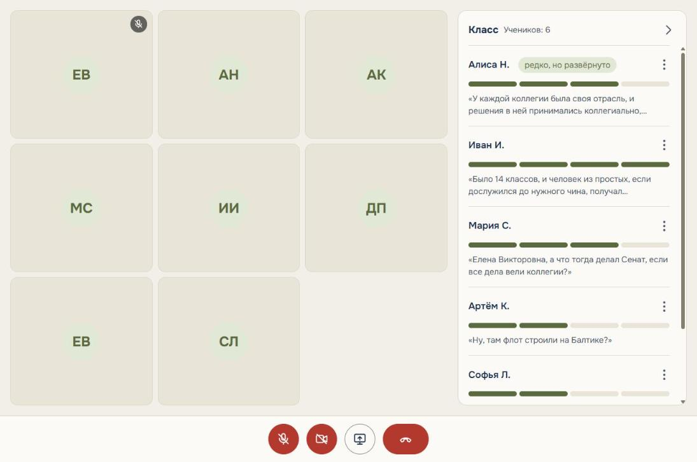
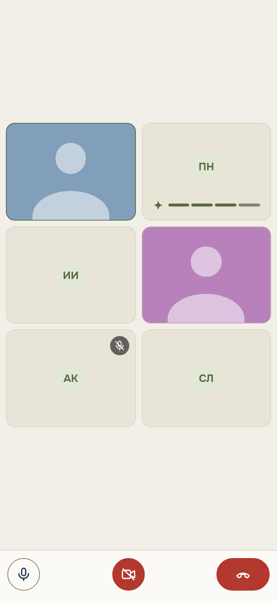
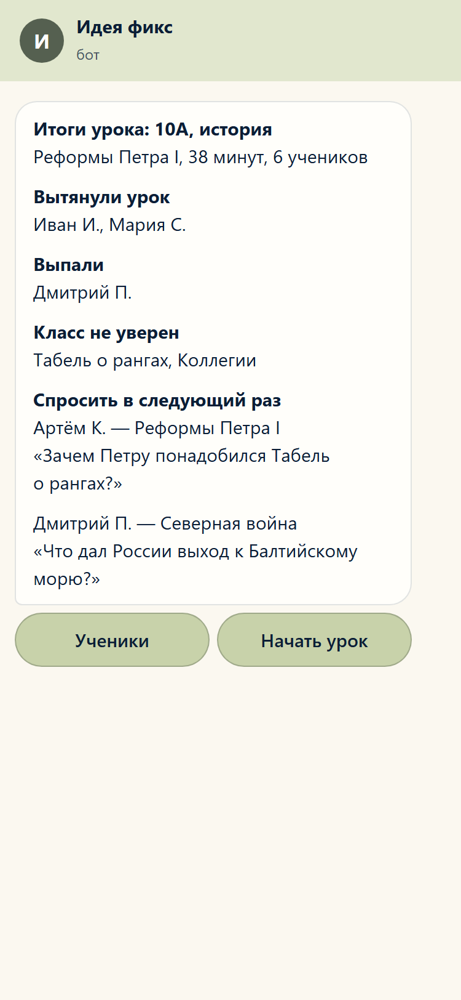
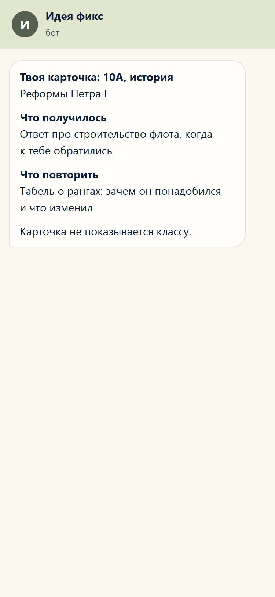

# Ассистент Сферум AI

Функция Сферума, которая слушает дистанционный урок и подсказывает учителю, кого из класса он давно не слышал и о чём его спросить.

Проект команды «Пиксель» для второго этапа хакатона. В MAX это бот и мини-приложение: бот открывает урок, в мини-приложении идёт звонок, а ассистент, скрытый участник звонка, слышит каждого ученика отдельно и ведёт шкалу участия.

> Статус: каркас. Звонок и вход в него написаны, распознавание, шкала и бот — заготовки с пометками `TODO(имя)`. Экраны пока получают события из моков. План работ — в [docs/PLAN.md](docs/PLAN.md).

## Как это выглядит

Экраны урока: учитель видит класс и шкалы участия, ученик — только свою шкалу, а после урока в чат приходит сводка.

**Панель учителя.** Плитки участников и панель класса: у каждого ученика шкала участия, метка и последняя реплика. Снято на демо-уроке с записанным классом.



**Экран ученика.** Своя шкала «Твоё участие» видна только ему, рейтингов нет.



**Бот после урока.** Сводка учителю и карточка ученику.

 

Остальные состояния (вход, обрыв связи, тёмная тема, 30 учеников) — в [design/](design/README.md).

## Быстрый старт

Нужны Docker с Docker Compose и `git-lfs`: дорожки демо-урока лежат в Git LFS, без него вместо них скачаются указатели, и урок с записанным классом не запустится.

```bash
git lfs install
git clone https://github.com/frontmany/lesson_assistant.git && cd lesson_assistant
cp .env.example .env
docker compose up --build
```

Первая сборка — около 5 минут: в образ сразу скачивается модель распознавания GigaAM (около 850 МБ), и дальше урок не зависит от сети. Образ около 2,5 ГБ. Чтобы собрать быстрее и скачать модель при первом уроке: `docker compose build --build-arg PRELOAD_MODEL=0`.

В `.env` впишите `LIVEKIT_NODE_IP` — IPv4 машины в локальной сети (`ipconfig` / `ip addr`). Этот адрес LiveKit отдаёт браузерам для звука. Адрес контейнера с хоста недоступен, и вход висит на «Подключаемся…». Если адрес в сети сменился, обновите его и перезапустите `docker compose up -d livekit`.

Поднимаются приложение, LiveKit (звонок), PostgreSQL и Redis. Откройте в двух вкладках:

- http://localhost:8000/teacher.html — учитель;
- http://localhost:8000/student.html?id=artem_k — ученик.

В каждой нажмите «Войти в урок»: вкладки слышат друг друга, а шкалы двигаются по событиям из `webapp/mock/events.json`. Микрофон браузер даёт только на `localhost` или по `https`.

Пока урок не начат, экраны получают события из мока. Чтобы ассистент зашёл в звонок и начал слушать:

```bash
curl -X POST http://localhost:8000/api/lessons/10a-history-05/start
```

Модель распознавания уже в образе. Когда в `docker compose logs app` появится «ассистент слушает комнату», говорите во вкладке ученика: реплика с id ученика и текстом придёт в панель учителя, а в логе будет её задержка.

Завершить урок: ассистент выйдет из комнаты, дораспознает последние фразы и завершит урок. Если комната пуста 5 минут, урок завершается сам.

```bash
curl -X POST http://localhost:8000/api/lessons/10a-history-05/end
```

### Бот: классы и уроки

Если в `.env` есть `MAX_BOT_TOKEN`, бот запускается вместе с сервером и делит с ним базу. Незнакомому человеку он предлагает «Я учитель», «Я ученик» и «Посмотреть демо». Учитель создаёт класс и получает код и ссылку для учеников, ученик входит по ссылке или по коду. «Начать урок» открывает урок класса в мини-приложении, а когда учитель входит в звонок, ученики получают «Урок начался». Сценарии и тексты — `design/bot-registration.html`, таблицы — `app/db/classes.py`.

Без бота урок класса открывается по адресу `teacher.html?lesson=<id урока>`. Без параметра открывается демо-класс из `data/demo_lesson`.

### Урок без учеников: виртуальный класс

Записанный урок заходит в звонок ботами вместо учеников, ассистент обрабатывает его как живой. Так урок показывают в одиночку: учитель или жюри входят во вкладке учителя и слышат класс.

```bash
curl -X POST http://localhost:8000/api/lessons/10a-history-05/virtual-class    # начать урок с записанным классом
curl -X DELETE http://localhost:8000/api/lessons/10a-history-05/virtual-class  # боты выходят, урок идёт дальше
```

Дорожки записи лежат в Git LFS. Перед первой сборкой поставьте `git-lfs` и скачайте их, иначе вместо дорожек будут указатели и сервер ответит 503:

```bash
git lfs install && git lfs pull
```

### Только образ приложения

```bash
docker build -t lesson-assistant .
docker run --rm -p 8000:8000 --env-file .env lesson-assistant
```

Без LiveKit звонок не заработает, но экраны, API и командная строка работают.

### Без Docker (для разработки)

Нужен Python 3.12. LiveKit можно поднять отдельно: `docker compose up livekit`.

```bash
python -m venv .venv
.venv\Scripts\activate          # Windows
source .venv/bin/activate       # Linux / macOS
pip install -r requirements.txt -r requirements-dev.txt
cp .env.example .env            # и поставить LIVEKIT_URL=ws://localhost:7880
uvicorn app.main:app --reload
```

### Командная строка

```bash
# прогнать записанный урок через конвейер без звонка: транскрипт, шкалы и сводка в консоль
python -m app.cli replay data/demo_lesson

# завести записанный урок в звонок ботами: каждая дорожка — отдельный участник
python -m app.cli virtual-class data/demo_lesson --lesson 10a-history-05

# показать сводку учителю из мока
python -m app.cli mock-summary
```

В Docker:

```bash
docker compose run --rm app python -m app.cli replay data/demo_lesson
```

### Тесты

```bash
pytest
```

## Как это устроено

```
браузеры ──WebRTC──▶ LiveKit ──звук каждого участника──▶ скрытый участник ──▶ VAD ──▶ распознавание ──▶ шкала
    ▲                                                                                                     │
    └────────────────────────────── события шкалы по WebSocket ───────────────────────────────────────────┘
                                         после урока: сводка LLM ──▶ бот MAX ──▶ учитель и ученики
```

Подробнее — в [docs/architecture.md](docs/architecture.md), форматы событий — в [docs/contracts.md](docs/contracts.md), сервер с HTTPS и TURN — в [docs/deploy.md](docs/deploy.md).

## Структура и ответственные

| Папка | Что внутри | Ответственный |
|---|---|---|
| `app/call.py`, `app/sources/` | Комнаты и токены LiveKit, скрытый участник, виртуальный класс | Ярослав |
| `app/pipeline/vad.py`, `asr.py`, `runner.py` | Распознавание речи, сборка конвейера | Ярослав |
| `app/main.py`, `app/api/`, `app/ws/`, `app/db/` | Сервер, API, WebSocket, хранилище | Ярослав |
| `app/pipeline/classify.py`, `scoring.py` | Типы реплик, шкала, нормировка | Илья (правила), Ярослав (код) |
| `app/pipeline/summary.py`, `prompts/` | Сводка учителю и карточки ученикам | Илья (промпты), Фёдор (вызов LLM) |
| `app/bot/` | Бот MAX | Фёдор |
| `webapp/` | Мини-приложение: звонок, экраны учителя и ученика | Фёдор (код), Варвара (макеты) |
| `design/` | Макеты экранов, иконка и обложка бота | Варвара |
| `data/demo_lesson/` | Записанный урок, состав класса, эталонная разметка | Илья |
| `analytics/` | Замеры качества | Илья |
| `Dockerfile`, `docker-compose.yml`, `requirements.txt` | Сборка | Ярослав |
| `README.md`, `docs/` | Документация, сдача | Фёдор |

Задачи каждого — в [docs/tasks/](docs/tasks/). Как работаем с ветками и задачами — в [CONTRIBUTING.md](CONTRIBUTING.md).

## Переменные окружения

Все переменные описаны в [.env.example](.env.example). Без ключа LLM сводка строится по шаблону, без токена MAX бот не запускается, но веб-часть и звонок работают.

## Принципы, которые нельзя нарушать

- Аудио не пишется на диск: обрабатывается в памяти, храним только реплики.
- Ученик видит только свою шкалу, рейтингов нет.
- Оценку ставит учитель, система только предлагает.
- Неопознанный участник не засчитывается никому.
- Аналитика выключается в один клик, индикатор «Аналитика активна» виден весь урок.
